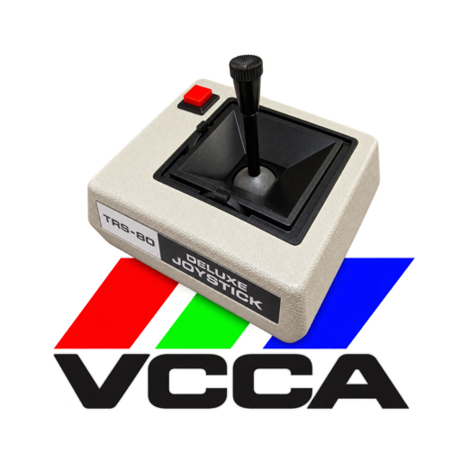
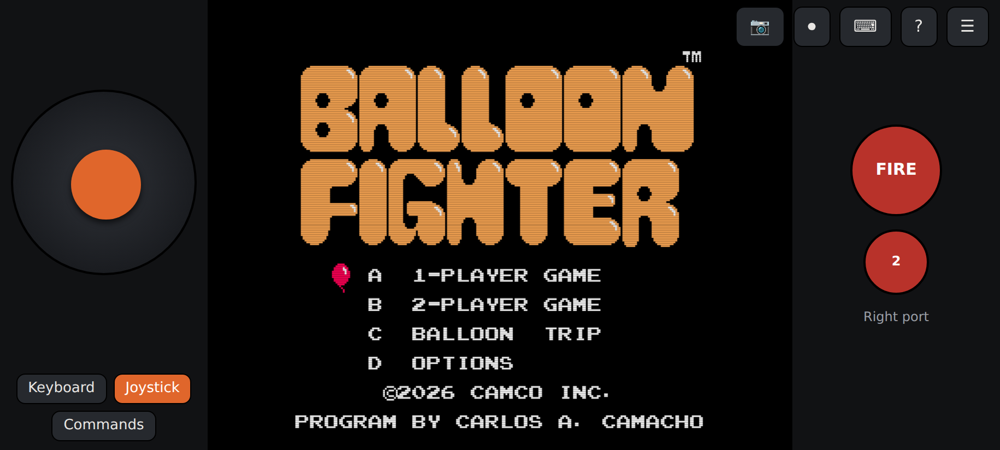
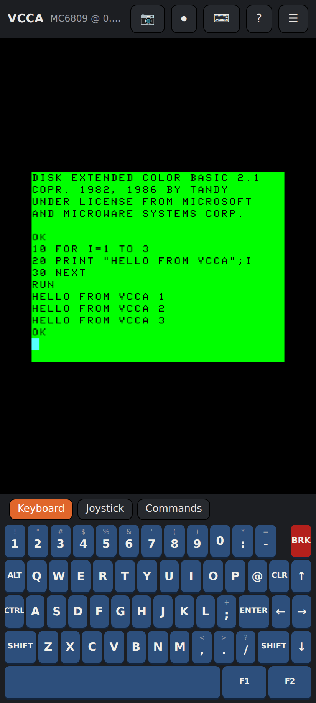
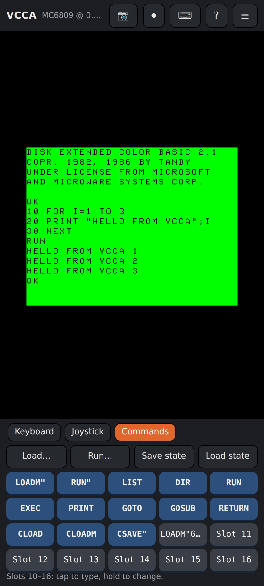
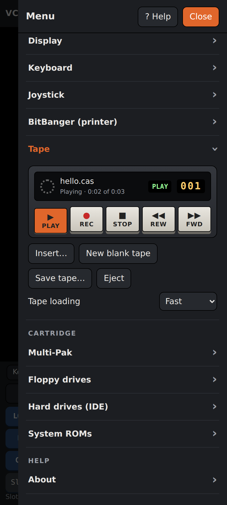
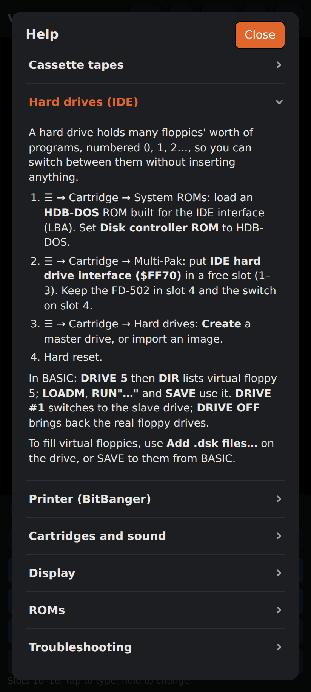

<p align="center">
  
</p>

# VCCA — VCC for Android

**VCCA** is a Tandy Color Computer 3 emulator for Android phones and tablets.
It runs the emulation core of [VCC (Virtual Color Computer)](https://github.com/VCCE/VCC),
the CoCo 3 emulator for Windows, with a touch front end: a CoCo 3 keyboard,
an on-screen joystick, a tape deck, floppy and IDE hard drives, and the
Multi-Pak sound cartridges.

Android port by **CoCoScene**.

<p align="center">
  
</p>
<p align="center"><sub><i>Balloon Fighter</i> by Carlos A. Camacho, in landscape with the on-screen joystick.</sub></p>

<p align="center">
  
  
  
  
</p>

### What it does

**Machine**
- CoCo 3 with a Motorola 6809 or Hitachi 6309, 128K to 8 MB, RGB or composite monitor
- Double-speed overclock; normal or fast-as-possible speed
- Save states: freeze the whole machine and come back to that exact moment, from the Commands tab or to a file
- Screenshots (PNG) and video with sound (MP4 where the device supports it)
- Scan lines drawn at the screen's own resolution, so they stay even at any size

**Loading, like XRoar**
- **Load…** / **Run…** take `.bin`, `.dsk`, `.cas`, `.wav`, `.rom` and `.ccc`. Run reads the disk directory or tape header and types the right `RUN"…"`, `LOADM"…":EXEC`, `CLOAD` or `CLOADM:EXEC`

**Storage**
- Four FD-502 floppy drives (`.dsk`), with blank disks and saving images back to the device
- Cassette deck: PLAY, REC, STOP, REW and FWD (skips to the next program); `.cas` and any `.wav`; VCC's fast loading
- IDE hard drives through HDB-DOS: numbered virtual floppies, created in the app or imported, with `.dsk` files added in bulk

**Cartridges (Multi-Pak)**
- FD-502 disk controller, program paks, Orchestra-90 CC, Speech/Sound Pak, Game Master Cartridge
- Stereo Composer, Symphony 12 and CoCo PSG, which need no ROM
- Glenside-compatible IDE interface at `$FF70` or `$FF50`

**Other**
- BitBanger printer capture (`LLIST`, `PRINT#-2`) to text
- Type a whole BASIC listing in, or copy the screen's text out
- ROMs, disks, tapes and settings stay on the device between runs
- Built-in Help covers every feature, including step-by-step hard drive setup, and **Report a bug** opens the bug form with your version and device filled in

More in [docs/design.md](docs/design.md). Not ported yet: the Becker port and
DriveWire, VCC's VHD hard disk pak, the **CoCoSDC**, the RS-232 pak and VCC's
debugger windows.

## Requirements

- **Android 5.0 or later** for `VCCA.apk` (Android 7.0 or later from Google
  Play), with **Android System WebView version 80 or later** (on Android 7 to
  9, **Chrome** 80 or later), updated from the Play Store. On an older WebView
  VCCA says so instead of starting.
- **The CoCo 3 ROM, `coco3.rom`**, and for floppies **`disk11.rom`**. They are
  copyrighted and not included; if you use VCC on Windows, both are in its
  folder. HDB-DOS for hard drives is built separately (see Building).
- Optional: a physical keyboard or game controller.
- VCCA does not emulate a **CoCoSDC** or DriveWire; floppies are `.dsk` images
  in the four FD-502 drives, hard drives go through HDB-DOS.

## Running

Download `VCCA.apk` from [Releases](https://github.com/CarlosCamacho/vcca/releases)
and open it on your device; Android asks once to allow installs from your
browser or file manager. It installs over earlier releases and keeps your
ROMs, disks and settings.

On first start, pick **coco3.rom** and **disk11.rom**. Then use ☰ → File →
**Run…** on a `.dsk`, `.bin`, `.cas` or `.wav`: VCCA types the right
`RUN"…"`, `LOADM"…":EXEC` or `CLOAD` for you. **Load…** inserts it without
running it.

VCCA has its own version number, independent of VCC's and of Android's.
☰ → Help → About shows it alongside the VCC version it is built on
(VCC 2.1.10.0).

## Controls

- On-screen CoCo 3 keyboard in the XRoar layout, with sticky SHIFT, CTRL and ALT
- Physical keyboards, with VCC's special keys (F3/F4 overclock, F5 reset, F6 monitor, F7 pause, F8 throttle, F9 hard reset, F11 full screen)
- Left and right joystick ports, as in VCC: on-screen stick or game controller, touch on screen, keyboard, or none. Standard, Tandy Hi-Res or CC-MAX emulation per port
- In landscape: stick, screen and fire buttons side by side, swappable for left-handed play
- **Commands** tab: one-tap `LOADM"`, `RUN"`, `LIST`, `DIR`, `RUN`, `EXEC`, `CLOAD`, `CLOADM`, `CSAVE"` and more, plus seven slots for your own commands

Back closes an open menu or dialog; with none open it puts VCCA in the
background, still running.

## Building

Ubuntu 24.04 packages:

```
sudo apt install clang lld wasi-libc libc++-dev-wasm32 libclang-rt-dev-wasm32 \
  android-sdk-platform-23 aapt apksigner zipalign android-sdk-build-tools default-jdk
```

Pinned: **clang 18** (`build.sh` checks it), the Ubuntu 24.04 Android SDK
packages (android-23 platform, aapt2 2.19), **bundletool 1.18.3** (fetched
and checksummed by the build), **LWTOOLS 4.21** for the test ROMs.

```
./build.sh                                   # -> build/vcc.wasm
VCCA_KEYSTORE_PASS=… ./build.sh              # -> also dist/VCCA.apk and dist/VCCA-play.aab
```

The second form builds both Android packages and verifies them: signatures,
the signing certificate, package names, versions and Android levels, and the
bundle's structure.

| | `dist/VCCA.apk` | `dist/VCCA-play.aab` |
|---|---|---|
| For | GitHub releases, sideloading | Google Play |
| Runs on | Android 5.0+ (API 21) | Android 7.0+ (API 24) |
| Targets | API 34 | API 36, as Play requires |
| Package | `com.vcce.vcc` | `com.cocoscene.vcca` (`$VCCA_PLAY_ID`) |

The signing key is not in this repository. The build uses
`./vcc-release.keystore`, or `$VCCA_KEYSTORE`, and makes a new key if there is
none. An update installs over an existing app only if it is signed with the
same key, so a build signed with a different key must be installed fresh. The
same key signs the Play bundle as its upload key. The version is in `VERSION`.

To try the front end in a desktop browser: `test/run.sh --serve`, then open
http://127.0.0.1:8765/.

### HDB-DOS

HDB-DOS is not included, because it contains Disk BASIC code. Build it from
ToolShed (needs [LWTOOLS](http://www.lwtools.ca/)):

```
git clone https://github.com/nitros9project/toolshed
make -C toolshed/cocoroms ecb_equates.asm
make -C toolshed/hdbdos hdblba.rom      # IDE, LBA, at $FF70
```

Load `hdblba.rom` in VCCA under Cartridge → System ROMs, and set
**Disk controller ROM** to HDB-DOS.

## Testing

```
test/run.sh            # after ./build.sh
```

Needs Node with Playwright (`npm i playwright`) and `coco3.rom` and
`disk11.rom` in `roms/` (ignored by git, as is every `.rom`). The tests drive
the real front end in Chromium, or run test ROMs against `vcc.wasm` directly;
[test/README.md](test/README.md) lists them.

**What has been tested where:** [docs/testing.md](docs/testing.md). In short,
every result so far comes from Chromium on a desktop, the owner's Android
devices and BlueStacks. **Nothing has been checked on a real CoCo 3**, and the
Play build's Android 15/16 code has not run on a device yet.

### Reporting bugs

Found something that doesn't work? [Open a bug report](https://github.com/CarlosCamacho/vcca/issues/new/choose).
The form asks for your VCCA version, device and the steps to reproduce it;
☰ → Help → **Report a bug** fills the first two in. See
[CONTRIBUTING.md](CONTRIBUTING.md).

## Files

```
src/core/       VCC 2.1.10.0's emulation core (C++), with VCCA's fixes
src/compat/     a minimal Windows.h for it
src/port/       glue: frames, audio, cartridges, tape, file access
src/web/        the front end (HTML/JS)
src/android/    manifest, MainActivity.java, launcher icons
tools/          build-android.sh, make-icons.sh, screenshots.mjs and helpers
test/           test ROMs (.asm + assembled .raw), harnesses, run.sh
assets/icon/    the icon artwork everything else is made from
docs/           design, technical notes, decisions, test log, screenshots
dist/           the current release: VCCA.apk and SHA256SUMS
VERSION         the version, read by the build
CHANGELOG.md    every release, with what each one taught
```

How it fits together is in [docs/technical.md](docs/technical.md).

## Credits and license

VCCA is free software under the [GNU General Public License v3.0](LICENSE)
or (at your option) any later version, as VCC is.

- **[VCC](https://github.com/VCCE/VCC)**, copyright 2015 Joseph Forgione. Repository and
  releases maintained by Bill Pierce and Ed Jaquay. Adapted to Visual Studio
  by Gary Coulbourne and Wes Gale; Hitachi 6309 port by Walter Zambotti. Bug
  fixes and enhancements by Bill Pierce, James Ross, Peter Westberg, James
  Rye, EJ Jaquay, Mike Rojas, Trey Tomes and Craig Allsop. GPL v3.
- **MAME** cartridge drivers, ported (BSD-3-Clause, notices kept in the
  sources): Stereo Composer, Symphony 12 and Speech/Sound Pak by tim lindner;
  CoCo PSG by Roberto Fernandez and Nigel Barnes (thanks to Ed Snider);
  Glenside IDE by Nigel Barnes; Orchestra-90 by Nathan Woods.
- **HDB-DOS** by Boisy G. Pitre and contributors (ToolShed project), not
  included.
- The CoCo 3 and Disk BASIC ROMs are copyrighted by Tandy and Microsoft and
  are not included.

VCCA collects nothing and has no network code of its own: see
[PRIVACY.md](PRIVACY.md).
